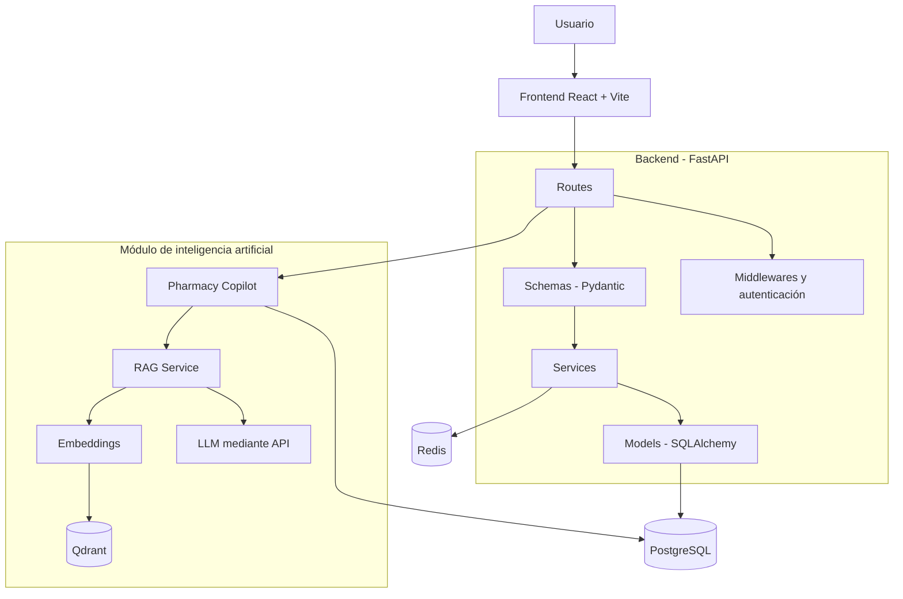

# PharmaSphere

Plataforma full-stack de gestión farmacéutica y comercio electrónico. Integra PostgreSQL para operaciones transaccionales e inventario, Qdrant para búsqueda semántica y un pipeline RAG para consultar documentación e información operativa.

Incluye Pharmacy Copilot, un asistente de inteligencia artificial capaz de combinar recuperación semántica con consultas estructuradas para analizar inventario, detectar productos próximos a vencer, interpretar tendencias de ventas y generar recomendaciones basadas en el contexto del negocio.

## Enfoque

El sistema tiene dos frentes principales:

- **Cliente:** catálogo de productos, búsqueda, carrito y compra en línea.
- **Administración:** inventario multi-sucursal, ventas, proveedores, recetas, reportes y Pharmacy Copilot.

## Tecnologías

**Frontend**

- React 19
- Vite
- Tailwind CSS v4
- Context API para autenticación y carrito

**Backend**

- FastAPI
- SQLAlchemy
- Alembic
- Pydantic
- PostgreSQL 16

**IA / RAG**

- Qdrant como base de datos vectorial.
- sentence-transformers para generación de embeddings.
- LLM mediante API para generación de respuestas.
- Recuperación semántica de documentos y productos.

**Infraestructura**

- Docker y Docker Compose.
- Redis para almacenamiento en caché.
- Servicios independientes para base de datos, motor vectorial y backend.

## Arquitectura del sistema

PharmaSphere utiliza una arquitectura por capas que separa las responsabilidades de presentación, procesamiento de solicitudes, lógica de negocio y persistencia.

### Diagrama general



### Descripción de las capas

| Capa        | Responsabilidad                                                                        |
| ----------- | -------------------------------------------------------------------------------------- |
| Routes      | Reciben las solicitudes HTTP y gestionan las respuestas.                               |
| Schemas     | Validan los datos de entrada y salida mediante Pydantic.                               |
| Services    | Implementan la lógica de negocio y las operaciones del sistema.                        |
| Models      | Representan las entidades y relaciones de PostgreSQL mediante SQLAlchemy.              |
| Middlewares | Gestionan aspectos transversales como autenticación y manejo de errores.               |
| RAG         | Recupera información relevante de documentos y productos mediante embeddings y Qdrant. |

### Flujo de una solicitud

1. El frontend realiza una solicitud HTTP.
2. FastAPI recibe la solicitud mediante el router correspondiente.
3. Los schemas validan los datos recibidos.
4. El service ejecuta la lógica de negocio.
5. Los models permiten consultar o modificar PostgreSQL.
6. FastAPI devuelve una respuesta estructurada al frontend.

Para las consultas del Pharmacy Copilot, el flujo puede incorporar recuperación semántica mediante Qdrant y generación de respuestas mediante el LLM.

## Documentación de la API

La API utiliza FastAPI y genera automáticamente documentación mediante OpenAPI.

Con el backend en ejecución, se puede acceder a:

| Recurso                | Dirección                          |
| ---------------------- | ---------------------------------- |
| Swagger UI             | http://localhost:8010/docs         |
| ReDoc                  | http://localhost:8010/redoc        |
| Especificación OpenAPI | http://localhost:8010/openapi.json |
| Health check           | http://localhost:8010/health       |

Swagger organiza los endpoints por módulos mediante tags e incluye descripciones y ejemplos de solicitudes.

### Cómo probar un endpoint

1. Abrir `/docs`.
2. Seleccionar el módulo correspondiente.
3. Expandir el endpoint.
4. Presionar `Try it out`.
5. Introducir los parámetros o el cuerpo JSON.
6. Presionar `Execute`.
7. Revisar el código de respuesta y el resultado.

Algunos endpoints requieren autenticación y permisos específicos según el rol del usuario.

### Principales módulos documentados

| Módulo    | Funcionalidad                        |
| --------- | ------------------------------------ |
| auth      | Autenticación y sesiones.            |
| products  | Catálogo de productos.               |
| branches  | Sucursales.                          |
| employees | Empleados.                           |
| inventory | Existencias, lotes y transferencias. |
| sales     | Ventas y pedidos.                    |
| purchases | Compras y recepción.                 |
| suppliers | Proveedores.                         |
| customers | Clientes.                            |
| recipes   | Recetas médicas.                     |
| reports   | Indicadores y reportes.              |
| ai        | Pharmacy Copilot y RAG.              |

## Datos de demostración

PharmaSphere incorpora datos iniciales para facilitar las pruebas funcionales y las presentaciones.

Los datos se encuentran organizados en:

```text
backend/app/db/init/
├── init.sql
├── seed.sql
└── seed_demo.sql
```

### Datos incluidos

El seed original contiene:

- Tres sucursales.
- Ocho productos.
- Tres proveedores.
- Cuatro empleados.
- Tres clientes.
- Registros de inventario.
- Compras y detalles de compra.
- Lotes de productos.
- Ventas iniciales.
- Documentos de referencia.

El seed de demostración amplía la información con:

- 180 ventas distribuidas en los últimos 180 días.
- Diferentes productos, cantidades y sucursales.
- Ventas online y de mostrador.
- Estados de venta variados.
- Lotes próximos a vencer.
- Actualización de las existencias correspondientes.

Los datos permiten probar las gráficas, reportes, indicadores y pronósticos del sistema.

Los scripts SQL de inicialización se ejecutan automáticamente al crear un volumen de PostgreSQL nuevo. En bases de datos existentes, los scripts adicionales deben ejecutarse manualmente.

## Documentos de demostración RAG

Los documentos utilizados para las pruebas del Pharmacy Copilot se encuentran en:

```text
backend/app/rag/demo_documents/
├── manual_dispensa_demo.md
├── politica_vencimientos_demo.md
└── guia_ventas_demo.md
```

Durante el inicio del backend, el servicio `embedding_service` utiliza `cargar_carpeta()` para registrar los documentos e indexar sus fragmentos en Qdrant.

El mecanismo comprueba los nombres de archivo previamente registrados para evitar duplicaciones en reinicios posteriores.

Los documentos de demostración permiten realizar consultas relacionadas con:

- Procedimientos de dispensación.
- Control de vencimientos.
- Método FEFO.
- Análisis de ventas.
- Indicadores comerciales.

## Modelo de embeddings

Modelo elegido: `intfloat/multilingual-e5-small` (384 dimensiones, ejecución en CPU).

Se comparó con diez preguntas en español sobre diez documentos de farmacia:

| Modelo                                | Dimensiones | Top-1 | Top-3 | Tiempo de embedding |
| ------------------------------------- | ----------: | ----: | ----: | ------------------: |
| paraphrase-multilingual-MiniLM-L12-v2 |         384 |  6/10 |  9/10 |              0.43 s |
| multilingual-e5-small                 |         384 |  8/10 | 10/10 |              0.34 s |
| multilingual-e5-base                  |         768 |  8/10 | 10/10 |              0.95 s |

### Justificación de la elección

- Mayor precisión que MiniLM en las búsquedas realizadas en español.
- Rendimiento similar a e5-base con menos dimensiones.
- Menor consumo de almacenamiento en Qdrant.
- Menor tiempo de generación de embeddings.
- Tamaño aproximado de 471 MB frente a 1.11 GB de e5-base.

### Consideraciones técnicas

- Los modelos e5 necesitan los prefijos `query:` y `passage:`.
- La implementación se encuentra en `app/rag/embeddings.py`.
- El modelo se configura mediante `EMBEDDING_MODEL` en `backend/.env`.
- Si se cambia a un modelo con otra dimensión, se debe recrear la colección de Qdrant.
- Los modelos se almacenan en el volumen `pharmasphere_hf_cache` para evitar descargas repetidas.

Pruebas de conexión e implementación:

```bash
docker compose exec backend python -m app.test.test_qdrant
```

## Estructura del proyecto

```text
PharmaSphere/
├── docker-compose.yaml
├── backend/
│   ├── Dockerfile
│   ├── .dockerignore
│   ├── requirements.txt
│   └── app/
│       ├── app.py
│       ├── core/
│       │   └── config.py
│       ├── db/
│       │   ├── base.py
│       │   ├── session.py
│       │   ├── pharmasphere.dbml
│       │   └── init/
│       │       ├── init.sql
│       │       ├── seed.sql
│       │       └── seed_demo.sql
│       ├── models/
│       │   ├── customer_model.py
│       │   ├── inventory_model.py
│       │   ├── lot_model.py
│       │   ├── product_model.py
│       │   ├── purchase_model.py
│       │   ├── sale_model.py
│       │   ├── supplier_model.py
│       │   └── user_model.py
│       ├── schemas/
│       │   ├── ai_schema.py
│       │   ├── inventory_schema.py
│       │   ├── product_schema.py
│       │   ├── sale_schema.py
│       │   └── user_schema.py
│       ├── routes/
│       │   ├── ai_routes.py
│       │   ├── auth_routes.py
│       │   ├── customers_routes.py
│       │   ├── inventory_routes.py
│       │   ├── purchase_routes.py
│       │   ├── reports_routes.py
│       │   ├── sales_routes.py
│       │   └── suppliers_routes.py
│       ├── services/
│       │   ├── auth_service.py
│       │   ├── embedding_service.py
│       │   ├── forecast_service.py
│       │   ├── inventory_service.py
│       │   ├── purchase_service.py
│       │   ├── rag_service.py
│       │   ├── report_service.py
│       │   ├── sales_service.py
│       │   └── supplier_service.py
│       ├── rag/
│       │   ├── chunker.py
│       │   ├── embeddings.py
│       │   ├── loader.py
│       │   ├── retriever.py
│       │   ├── vector_store.py
│       │   └── demo_documents/
│       │       ├── manual_dispensa_demo.md
│       │       ├── politica_vencimientos_demo.md
│       │       └── guia_ventas_demo.md
│       ├── middlewares/
│       ├── dependencies/
│       ├── utils/
│       └── test/
└── frontend/
    ├── index.html
    ├── package.json
    ├── vite.config.js
    └── src/
        ├── App.jsx
        ├── main.jsx
        ├── components/
        ├── context/
        ├── hooks/
        ├── lib/
        └── pages/
```

## Servicios en Docker

| Servicio | Función         | Puerto externo |
| -------- | --------------- | -------------: |
| db       | PostgreSQL 16   |           5434 |
| qdrant   | Motor vectorial |           6335 |
| backend  | API FastAPI     |           8010 |
| redis    | Caché           |           6380 |

### Comandos principales

Iniciar los servicios:

```bash
docker compose up -d
```

Reconstruir el backend:

```bash
docker compose up -d --build backend
```

Consultar los logs:

```bash
docker compose logs -f backend
```

Consultar el estado de los contenedores:

```bash
docker compose ps
```
